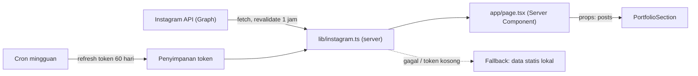

# Plan Eksekusi — Revisi Landing Page ZaCreative (Putaran 2)

Plan ini menjawab 4 catatan revisi: **(1)** 3 tombol di hero, **(2)** WhatsApp lebih menonjol + warna hijau, **(3)** opsi paket + harga langsung tampil di landing page, **(4)** portofolio diambil otomatis dari Instagram.

---

## 0. Temuan dari Audit Kode

| Temuan | Dampak |
|---|---|
| Semua link WhatsApp masih `https://wa.me/` **tanpa nomor** (Hero, FAQ, Footer, Modal, Detail) | Tombol WA belum benar-benar jalan |
| `ContactSection` di-comment di [LazyHomeSections.tsx](file:///home/xynerva/project/zacreative/components/sections/LazyHomeSections.tsx#L42-L44), tapi Navbar/Footer/Hero masih link ke `/#kontak` | Link `#kontak` mengarah ke section yang tidak ada |
| [ServicesSection.tsx](file:///home/xynerva/project/zacreative/components/sections/ServicesSection.tsx) cuma menampilkan 3 kartu layanan + estimasi waktu, **tanpa harga/tier** | Tidak sesuai wireframe |
| Portofolio masih hardcoded 4 item + link ke `/products/[id]` | Perlu update kode tiap ada karya baru |
| `lucide-react` v1 tidak lagi menyediakan ikon brand (Instagram/WhatsApp) | Pakai inline SVG sendiri |

---

## 1. Fondasi: Token Warna Hijau + Konfigurasi Kontak

**Warna** — diambil dari gradasi hijau logo (`#4FC97A`) di [globals.css](file:///home/xynerva/project/zacreative/app/globals.css#L5-L21):

```css
--color-leaf: #4fc97a;         /* hijau logo: aksen, dot, glow */
--color-leaf-strong: #1f8f50;  /* bg tombol WA (kontras teks putih ≥ 4.5:1) */
--color-leaf-hover: #187a43;
--color-leaf-tint: #ecfaf1;    /* bg section/kartu WA */
```

> [!NOTE]
> Hijau logo asli (`#4FC97A`) terlalu terang kalau dipakai sebagai bg tombol dengan teks putih (kontras ~2:1). Jadi untuk tombol pakai shade lebih gelap, hijau logo dipakai sebagai aksen.

**Konstanta baru** di [constants.ts](file:///home/xynerva/project/zacreative/lib/constants.ts):
- `CONTACT.whatsappNumber`, `CONTACT.instagramHandle`, `CONTACT.email`
- Helper `buildWhatsAppLink(message)` → semua tombol WA di seluruh situs pakai helper ini (satu sumber kebenaran).

**Komponen ikon**: `components/ui/BrandIcons.tsx` (WhatsApp + Instagram SVG).

---

## 2. Hero — 3 Tombol

File: [HeroSection.tsx](file:///home/xynerva/project/zacreative/components/sections/HeroSection.tsx#L181-L195)

| # | Label | Gaya | Aksi |
|---|---|---|---|
| 1 | **Konsultasi & Pemesanan** | Primary **hijau** + ikon WA | Buka WhatsApp dengan pesan pembuka otomatis |
| 2 | **Lihat Paket** | Secondary (outline navy) | Scroll ke `#paket` |
| 3 | **Lihat Portofolio** | Tertiary (outline) | Scroll ke `#portofolio` |

- Desktop: 1 baris (tombol 1 lebih lebar). Mobile: tombol 1 full-width, tombol 2 & 3 berdampingan 2 kolom → tetap ringkas, tidak jadi tumpukan 3 tombol panjang.
- Elemen pendukung kecil di bawah tombol: `● Online — biasanya dibalas < 1 jam` (dot hijau berdenyut).

---

## 3. WhatsApp Lebih Di-highlight (Hijau)

1. **Section CTA WhatsApp baru** — `components/sections/WhatsAppCtaSection.tsx`, `id="kontak"` (sekaligus memperbaiki link `#kontak` yang rusak).
   - Band lebar penuh dengan bg hijau (gradasi `leaf-strong → leaf`), judul besar, 3 poin singkat (Respon cepat · Gratis konsultasi · NDA tersedia), tombol putih besar "Chat via WhatsApp".
   - Quick-chips pesan siap kirim: *"Tanya paket Layout Buku"*, *"Tanya paket Presentasi"*, *"Tanya paket Poster"* → masing-masing buka WA dengan teks berbeda.
   - Posisi: setelah FAQ, sebelum Footer.
2. **Tombol WhatsApp melayang (floating)** — `components/ui/FloatingWhatsApp.tsx`, pojok kanan bawah, muncul setelah scroll melewati hero, hormati `prefers-reduced-motion`, aman dari tumpang-tindih di mobile (safe-area inset).
3. **Seragamkan warna hijau** di: kotak "Fast Response" di [FaqSection.tsx](file:///home/xynerva/project/zacreative/components/sections/FaqSection.tsx#L54-L78) (sekarang biru → jadi hijau), tombol CTA di Navbar, link WA di [Footer.tsx](file:///home/xynerva/project/zacreative/components/layout/Footer.tsx#L97-L102), dan tombol WA di halaman produk.

---

## 4. Paket & Harga Langsung di Landing Page (sesuai wireframe terakhir)

**Data baru**: `lib/data/packages.ts` — struktur:

```ts
interface ServicePackage {
  id: "layout-buku" | "presentasi" | "poster";
  number: "01" | "02" | "03";
  title: string;            // "Layout & Tata Letak Buku"
  summary: string;
  formatChip: string;       // "Format: InDesign / PDF Print Ready"
  unit: "/hal" | "/slide" | "/desain";
  tiers: {
    id: "bronze" | "silver" | "gold";
    label: string;          // "Paket Standar" | "Paket Editorial" | "Paket Premium"
    name: string;           // "Tier Bronze"
    priceRange: string;     // "Rp 15k–25k"
    description: string;
    features: string[];     // konsep, revisi, waktu kerja, output
    popular?: boolean;
  }[];
}
```

**Komponen baru**: `components/sections/PackagesSection.tsx` (menggantikan `ServicesSection` di home), `id="paket"`:
- Header: label `[KATALOG & PAKET LAYANAN]`, judul **"Layanan & Tingkatan Paket"**, counter `01 / 03` + tombol ‹ ›.
- **Tab layanan**: `01. Layout & Tata Letak Buku` · `02. Presentasi & Pitch Deck` · `03. Poster & Kampanye Visual` (ARIA `tablist`, bisa navigasi keyboard ←/→).
- **Panel layanan**: nomor, judul, deskripsi, chip format, link "Pesan Layanan ↗".
- **3 kartu tier** Bronze / Silver (badge *PALING POPULER*, sedikit lebih menonjol) / Gold — harga mulai + satuan, deskripsi, checklist fitur, tombol **"Pilih Bronze/Silver/Gold"** → WhatsApp dengan pesan otomatis: *"Halo ZaCreative, saya tertarik dengan Layout Buku – Tier Silver (Rp 30k–50k/hal)…"*.
- **Mobile**: tab jadi scroll horizontal; kartu tier jadi carousel swipe (scroll-snap) dengan dot indicator, Silver tampil pertama di tengah.
- Animasi halus saat ganti tab (fade/slide), tetap ringan.

**Urutan section home yang baru** (paket naik ke atas karena paling penting):

```
Hero → Trust Indicators → Paket & Harga → Portofolio (IG) → Proses → FAQ → CTA WhatsApp → Footer
```

Navbar & Footer diperbarui: "Layanan" → "Paket" (`#paket`), "Kontak" → `#kontak` (section WA baru).

---

## 5. Portofolio dari Instagram + Plan Autofetch

### 5a. Tampilan

`components/sections/PortfolioSection.tsx` dirombak:
- Grid thumbnail persegi (mobile 2 kolom, tablet 3, desktop 4) — 8 post terbaru.
- Ikon kecil di pojok untuk Carousel/Reels; hover (desktop) menampilkan overlay potongan caption + ikon IG.
- Klik → buka **post tersebut di Instagram** (tab baru). Tidak ada halaman detail portofolio lagi.
- Header: `[PORTOFOLIO]` "Karya Terbaru dari Instagram" + tombol **"Follow @zacreative.id"**.

### 5b. Arsitektur Autofetch



- **`lib/instagram.ts`** (server-only): ambil `GET graph.instagram.com/me/media?fields=id,caption,media_type,media_url,thumbnail_url,permalink,timestamp&limit=8`, normalisasi (Reels pakai `thumbnail_url`), dengan revalidasi berkala (ISR, mis. tiap 1 jam) → **upload di IG otomatis muncul di website maksimal ±1 jam kemudian, tanpa deploy ulang**.
- **Fallback**: kalau API gagal/token belum di-setup, tampilkan daftar statis lokal (`lib/data/instagram-fallback.ts`) supaya section tidak pernah kosong.
- Karena `LazyHomeSections` adalah Client Component, data diambil di `app/page.tsx` (server) lalu dioper sebagai props.
- `next.config.ts`: tambah `images.remotePatterns` untuk `*.cdninstagram.com` & `*.fbcdn.net` (CSP `img-src https:` sudah mengizinkan).
- Implementasi akan mengikuti docs Next.js 16 lokal (`node_modules/next/dist/docs`) untuk caching/revalidate & `next/image`.

### 5c. Opsi Sumber Data (perlu dipilih)

| Opsi | Cara kerja | Kelebihan | Kekurangan |
|---|---|---|---|
| **A. Instagram Graph API (resmi)** ⭐ | Akun IG Business/Creator + Meta App → token jangka panjang (berlaku 60 hari, di-refresh otomatis via cron) | Gratis, resmi, data lengkap, kontrol penuh | Setup awal ±30 menit di Meta Developer; perlu penyimpanan token (mis. Vercel KV/Upstash) + cron refresh |
| **B. Layanan pihak ketiga (Behold.so, dll.)** | Hubungkan IG di dashboard mereka → dapat URL JSON feed | Setup 5 menit, tanpa urus token | Bergantung vendor; tier gratis terbatas (jumlah post/refresh) |
| **C. Manual kurasi** | Admin tempel link post + thumbnail ke file data | Tanpa dependensi | Tidak otomatis |

> [!IMPORTANT]
> Instagram Basic Display API sudah dimatikan Meta (Des 2024), jadi opsi resmi satu-satunya adalah **Instagram API with Instagram Login** (Opsi A) — wajib akun **Business/Creator**.

**Langkah setup Opsi A** (akan dibuatkan panduan `docs/instagram-setup.md`):
1. Ubah akun IG ke Professional (Business/Creator).
2. Buat Meta App → tambah produk "Instagram API with Instagram Login" → generate token.
3. Simpan `INSTAGRAM_ACCESS_TOKEN` di env (`.env.local` & dashboard hosting).
4. Route `app/api/cron/refresh-instagram-token` + jadwal cron mingguan (dilindungi `CRON_SECRET`).

---

## 6. Rencana Perubahan File

| Status | File |
|---|---|
| ✏️ Ubah | `app/globals.css`, `lib/constants.ts`, `next.config.ts`, `app/page.tsx` |
| ✏️ Ubah | `HeroSection.tsx`, `FaqSection.tsx`, `PortfolioSection.tsx`, `LazyHomeSections.tsx`, `Navbar.tsx`, `Footer.tsx` |
| ✏️ Ubah | `ProductInquiryModal.tsx`, `ProductDetailView.tsx` (nomor WA + warna hijau saja) |
| 🆕 Baru | `lib/data/packages.ts`, `components/sections/PackagesSection.tsx` |
| 🆕 Baru | `components/sections/WhatsAppCtaSection.tsx`, `components/ui/FloatingWhatsApp.tsx`, `components/ui/BrandIcons.tsx` |
| 🆕 Baru | `lib/instagram.ts`, `lib/data/instagram-fallback.ts`, `app/api/cron/refresh-instagram-token/route.ts`, `docs/instagram-setup.md` |
| 💤 Tidak dipakai di home | `ServicesSection.tsx`, `ContactSection.tsx` (dibiarkan, bisa dihapus setelah approve) |

---

## 7. Urutan Eksekusi

1. Fondasi: token hijau, konstanta kontak, helper WA, ikon brand.
2. Hero 3 tombol.
3. `PackagesSection` + data paket → ganti posisi di home.
4. CTA WhatsApp section + floating button + seragamkan warna hijau.
5. Portofolio IG: tampilan + `lib/instagram.ts` dengan **fallback statis dulu** (bisa jalan sebelum token tersedia).
6. Sambungkan API IG asli setelah token tersedia + cron refresh.
7. Verifikasi: `bun run lint`, `bun run build`, cek visual di browser (desktop 1440px & mobile 390px, light & dark mode).

---

## 8. Pertanyaan yang Perlu Dijawab Sebelum Eksekusi

1. **Nomor WhatsApp** bisnis ZaCreative (format `62812…`)?
2. **Harga per tier**: wireframe hanya berisi harga Layout Buku (Bronze 15–25k/hal, Silver 30–50k/hal, Gold 65–100k/hal). Berapa harga & satuan untuk **Presentasi** (per slide?) dan **Poster** (per desain?)? Kalau belum ada, saya isi placeholder realistis dulu yang gampang diganti.
3. **Handle IG** benar `@zacreative.id`? Sudah akun Business/Creator?
4. **Sumber data IG**: Opsi A (Graph API resmi), B (Behold), atau mulai C dulu lalu upgrade ke A?
5. Klik thumbnail → ke **post spesifik** (rekomendasi) atau ke **halaman profil** IG?
6. Halaman `/products` & `/products/[id]` (katalog studi kasus lama): **dipertahankan**, atau **dihapus/redirect** karena portofolio sudah pindah ke IG dan paket sudah ada di home?
7. Hosting di mana (Vercel / lainnya)? Ini menentukan cara cron refresh token & penyimpanan token.
